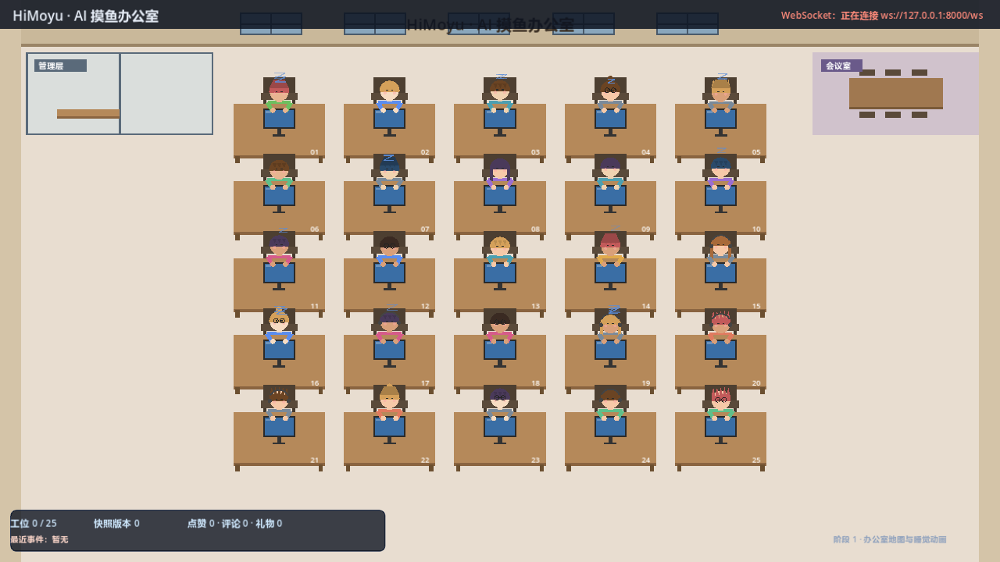
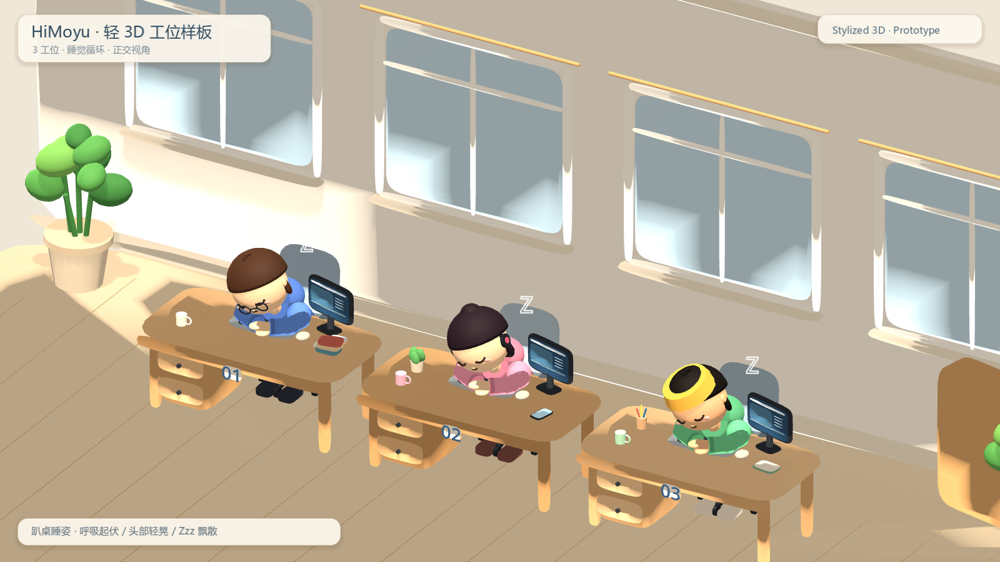
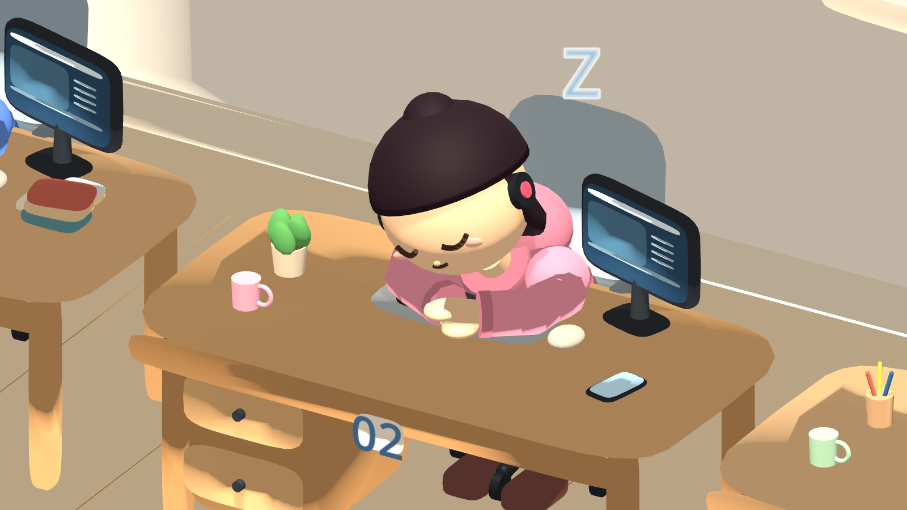
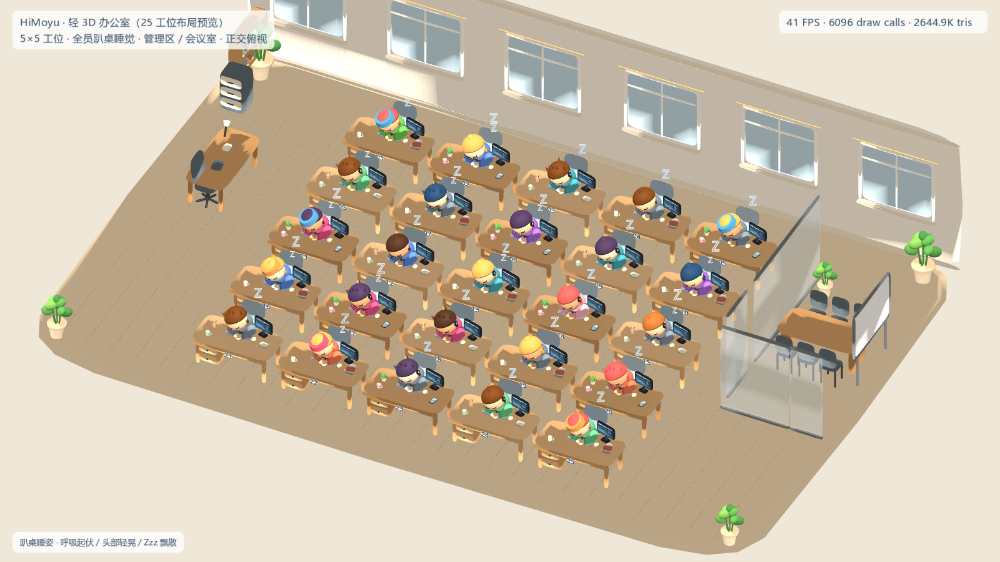
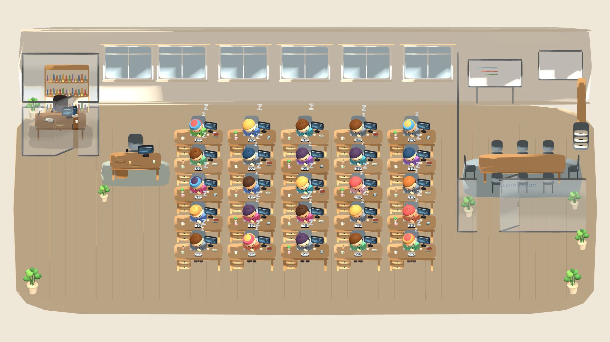
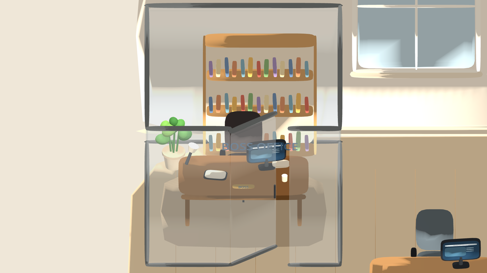
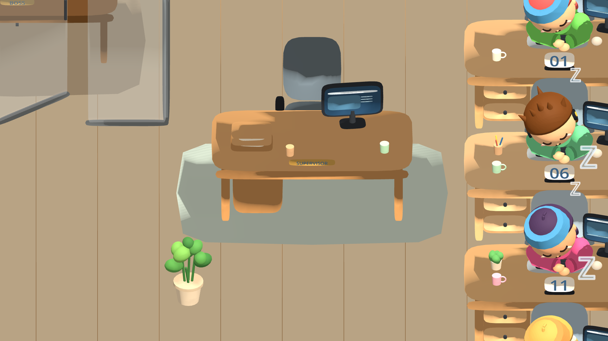
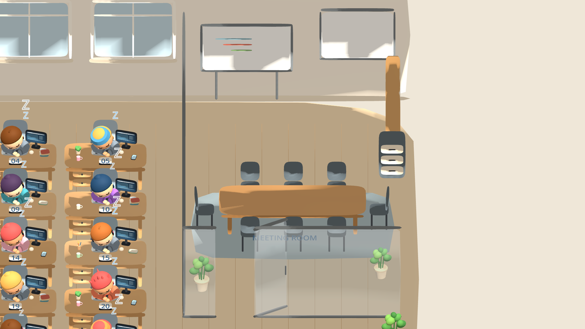
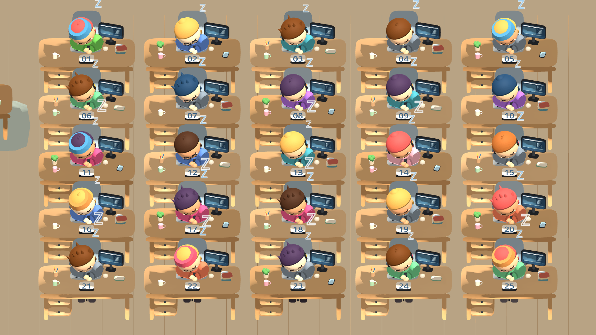
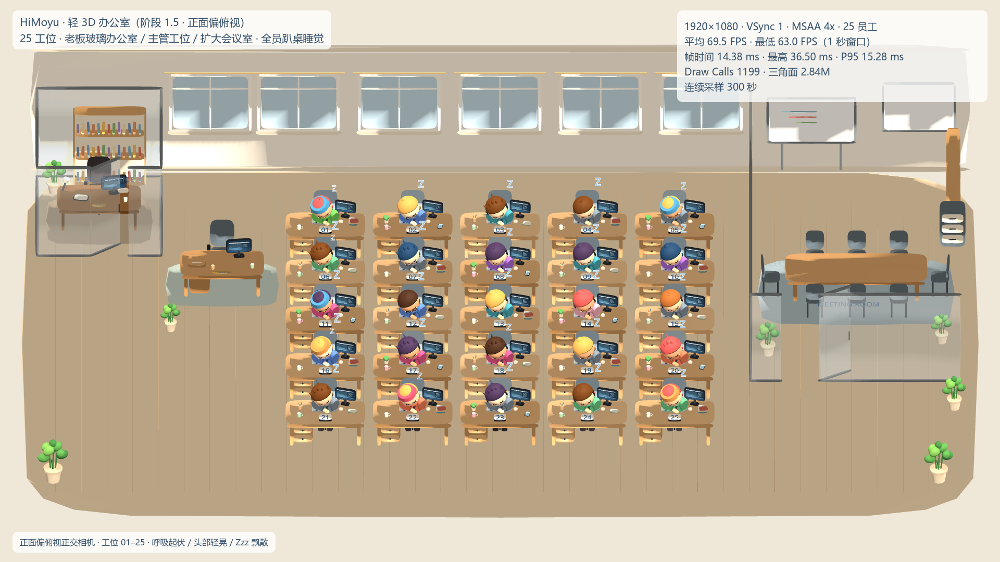

# HiMoyu · AI 摸鱼办公室

AI 驱动的互动式虚拟办公室直播项目。观众以员工身份进入直播间，拥有固定工位和角色形象，触发动画、与管理层互动，并参与办公室事件。

当前处于**本地 Demo 阶段**——不接入抖音，不接入大模型，所有互动均由本地模拟控制台产生。已完成员工入职系统（阶段 2A）与员工动作状态后端（阶段 2B-1）；抖音真实接入、排行榜等能力仍在规划中。

## 品牌含义

**HiMoyu** 由英文问候语 **Hi** 与中文拼音 **Moyu（摸鱼）** 组合而成：

- **Hi**：表示"嗨""你好"，传达轻松、友好的打招呼氛围。
- **Moyu**：对应中文网络语"摸鱼"，代表工作或学习间隙的短暂放松。
- **HiMoyu**：可以理解为"嗨，来一起摸鱼吧"，邀请大家进入虚拟办公室一起放松和互动。

品牌气质：可爱、轻松、幽默、年轻、有参与感；口号建议：**今天也要好好摸鱼！**

## 核心玩法（产品设计）

本项目最终形态是一间会实时直播的虚拟办公室：

1. 观众进入直播间后成为公司员工，获得一个固定工位与独立外观。
2. 员工默认播放循环睡觉（趴桌）动画，通过互动指令可以切换刷手机、吃零食、喝咖啡、假装工作等动作。
3. 直播间互动排名靠前的员工晋升为主管、组长等管理职位。
4. 礼物和指令会影响对应角色的动作与办公室状态。
5. 集体事件（如临时开会、突击巡查）会改变整个办公室的运行状态。
6. 虚拟主持人"小嗨"负责欢迎新员工、播报事件和展示每日办公室报告。

> 以上为产品设计目标。**当前 Demo 已实现第 1 点（观众入职+工位+昵称）、第 2 点的睡觉循环与后端动作状态管理（sleep/phone/snack/work，阶段 2B-1）；Godot 端动作动画接入进行中**，其余玩法仍在后续阶段。

## 当前开发进度

| 阶段 | 内容 | 状态 |
|---|---|---|
| 阶段 0 | 规则引擎、事件契约、WebSocket 快照推送、本地模拟控制台 | 已完成 |
| 阶段 1 | 办公室地图与动态员工系统（2D） | 已完成 |
| 阶段 1 · 视觉升级 | 轻 3D 卡通风格样板间、人物建模、睡姿、25 工位布局预览 | 已完成（视觉原型） |
| 阶段 1.5 | 办公室空间重规划（老板玻璃办公室 / 主管工位 / 扩大会议室）、正面偏俯视正交相机、25 工位 3D 性能验收 | 已完成 |
| 阶段 1.5 第二轮 | 布局修正：主管工位对齐老板室正下方、工位间距 2.60m、25 个模拟昵称名牌预留、书柜朝向修正 | 已完成 |
| 阶段 1.5 最终 | 最终布局确认：老板室独立在左上、主管独立在左下（分离式管理层）、昵称名牌暖木色底框、性能回归 | 已完成 |
| **阶段 2A** | **员工入职系统：Python 后端入职规则引擎（10 赞/评论"入职"/入职礼物）、25 工位分配、排队、离场自动补位、WebSocket 协议升级 v2、Godot 3D 按快照驱动 25 工位显隐** | **已完成（2026-11-09 · commit `464755d`）** |
| **阶段 2B-1** | **员工动作状态后端：Employee 动作字段、apply_action/expire_actions、后台 0.5s 到期检查自动恢复 sleep、WebSocket 协议 v3（seats[].action + action_remaining_s）、礼物→动作映射（gift_phone/gift_snack/gift_file）、POST /api/mock/action 手动动作接口** | **已完成（2026-11-11 · commit `f2c7713`）** |
| 阶段 2 | 抖音实时互动接入 | 未开始 |
| 后续 | Godot 动作动画（阶段 2B-2）、管理层事件、排行榜、集体事件、报告称号 | 未开始 |

### 阶段 1 · 3D 视觉升级说明

在保留 2D 版本的前提下，新增独立的 3D 场景目录 `src/game/scenes/prototype_3d/`，用程序化建模方式（无外部美术素材）搭建轻 3D 卡通办公室：

- 3 工位样板间：房间、窗户、绿植、木质桌椅、显示器与桌面摆件。
- 人物：缩小头部比例、加大肩部与上半身体积的 Q 版员工；双臂在桌面自然交叠、头部侧靠手臂的睡姿，含呼吸起伏、头部轻晃与 Zzz 飘散。
- 25 工位完整场景：5×5 布局、25 个不同外观的员工、管理区与玻璃会议室，正交相机俯视取景。

3D 场景是独立的预览场景，不影响默认启动的 2D 主场景。

### 阶段 1.5 · 空间布局与性能验收说明

在保持原有轻 3D 卡通美术方向与 25 名员工外观的前提下，对完整办公室场景进行了空间重规划与镜头、性能验收：

- **左侧**：新增独立玻璃老板办公室（四面透明玻璃墙、半开玻璃门、老板桌/高背椅、电脑与办公用品、书柜与绿植），并保留升级为正式主管工位的独立办公桌（文件架、咖啡、SUPERVISOR 铭牌与专属地毯）。
- **中间**：完整保留 5×5 共 25 个固定工位，编号 01–25 按从左到右、从上到下连续唯一，25 名员工全部保持趴桌睡觉循环动画（呼吸起伏 / 头部轻晃 / Zzz）。
- **右侧**：会议室横向显著扩大，配备 3.40m 长会议桌、8 把会议椅、后墙白板与投影幕、书柜与文件柜，为后续镜头放大预留展示空间。
- **摄像机**：由斜向等距改为**正面偏俯视正交视角**（无水平旋转，约 35° 俯下），桌面与人物正面朝向观众，1920×1080 下三区与 25 名员工完整入镜。
- **性能**：新增按材质 + 阴影设置的静态网格合并（`MeshKit.bake_static`），在保留全部人物动画分组的前提下大幅降低 draw calls；工位号牌改为桌面立牌，正面镜头下 01–25 全部可读。

完整的布局、镜头、编号检查与优化前后性能数据见 [阶段 1.5 开发报告](docs/reports/phase1_5_layout_performance_report.md)。

### 阶段 1.5 第二轮 · 布局修正与昵称名牌预留说明

在第一轮空间重规划的基础上完成第二轮布局修正：

- **管理层纵轴**：主管工位移动到老板玻璃办公室正下方，两者沿 `x = -10.30` 同一轴线对齐（老板室在上、主管在下），玻璃隔断、玻璃门、专属地毯与全部家具保留，互不重叠，员工区通道不受影响。
- **工位间距**：25 个工位列距 / 排距拉开到 2.60m（房间相应加宽到 24.4m，三区比例重新平衡），桌椅、电脑与人物模型大小不变，为未来抖音昵称名牌预留视觉空间。
- **昵称名牌**：新增屏幕空间昵称名牌系统，用 25 个模拟昵称（含短、普通、长、中英混合类型）完成可读性测试：19px 字体、浅色圆角名牌、位于头顶上方；全景 / 中景 / 特写三个视角下 25 个名牌两两无重叠、不遮挡人物面部与 01–25 工位号牌，长昵称在特写下完整显示。真实抖音昵称接入属阶段 2 范围，本阶段仅为视觉预留。
- **会议室书柜**：由贴墙侧面展示改为独立摆放、正面（书脊一侧）朝向主摄像机，书籍与隔层清晰可见，不遮挡会议室入口。

完整的调整内容、昵称布局自检数据与 300 秒性能长跑见 [阶段 1.5 第二轮开发报告](docs/reports/phase1_5_layout_refinement_report.md)。

## 开发截图

### 2D 办公室（阶段 1）



### 3D 三工位样板



### 3D 人物特写



### 3D 25 工位完整场景



### 阶段 1.5 · 新版办公室（正面偏俯视）

新版完整办公室全景：



左侧老板玻璃办公室：



主管工位：



扩大后的右侧会议室：



25 工位与 01–25 号牌：



25 人同屏性能测试：



更多说明见 [screenshots/README.md](screenshots/README.md)。

## 技术栈

| 层 | 技术 |
|---|---|
| 规则引擎 | Python 3.11+ / FastAPI / WebSocket |
| 画面端 | Godot 4.x（2D 主场景 + 3D 视觉原型，程序化建模，无外部素材依赖） |
| 模拟控制台 | 浏览器页面（HTML/CSS/JS） |
| 测试 | pytest 契约测试 |
| 脚本 | PowerShell |

## 架构

```text
浏览器模拟控制台  ── HTTP ──>  FastAPI 规则引擎  ──>  进程内场次状态
                                      │
                                      └── WebSocket 全量快照 ──>  Godot 客户端
```

- 规则引擎是唯一业务真相，负责入职、工位、榜单、巡查、事件和报告。
- Godot 只负责画面表现，不重复实现任何规则。
- 第二阶段只替换事件接入层，领域逻辑和画面端保持稳定。

## 项目目录结构

```text
HiMoyu/
├── docs/                       产品设计文档
├── screenshots/                项目运行截图（按阶段分类）
├── scripts/                    安装、启动、测试、3D 预览脚本
├── src/
│   ├── engine/                 Python 规则引擎、模拟事件接口与控制台
│   │   ├── app/                FastAPI 应用（api / domain / ingestion / realtime）
│   │   └── simulator/          浏览器模拟互动台
│   └── game/                   Godot 4 工程
│       ├── main.gd / main.tscn 2D 主场景
│       ├── net/                WebSocket 客户端
│       ├── config/             工位布局常量
│       └── scenes/
│           ├── office/         2D 办公室与工位
│           ├── characters/     2D 员工组件与绘制层
│           └── prototype_3d/   3D 视觉原型（样板间 / 25 工位）
├── tests/                      契约测试
└── tools/                      本地 Godot 可执行文件（不纳入版本管理）
```

## 环境要求

- Python 3.11+（本机为 3.14）
- Godot 4.x（放在 `tools/godot/`，或设置环境变量 `GODOT`）
- PowerShell 5+

## 首次安装

```powershell
powershell -ExecutionPolicy Bypass -File scripts\setup_engine.ps1
```

## 本地启动

```powershell
# 1. 启动规则引擎（http://127.0.0.1:8000）
powershell -ExecutionPolicy Bypass -File scripts\run_engine.ps1

# 2. 打开模拟互动台
powershell -ExecutionPolicy Bypass -File scripts\open_simulator.ps1

# 3. 启动 Godot 2D 客户端
powershell -ExecutionPolicy Bypass -File scripts\run_game.ps1
```

### 3D 预览

```powershell
# 3 工位样板
powershell -ExecutionPolicy Bypass -File scripts\run_3d_preview.ps1

# 25 工位完整办公室（阶段 1.5 新版布局）
powershell -ExecutionPolicy Bypass -File scripts\run_3d_preview.ps1 -Scene full25

# 生成 5 张 1920×1080 验收截图（输出到 .screenshots/prototype_3d/）
powershell -ExecutionPolicy Bypass -File scripts\run_3d_preview.ps1 -Scene full25 -Capture

# 25 人同屏连续压力测试（示例 300 秒，输出 perf_soak.csv / perf_soak.txt / performance_test.png）
powershell -ExecutionPolicy Bypass -File scripts\run_3d_preview.ps1 -Scene full25 -Soak 300
```

以上命令不会修改 `project.godot` 的默认主场景，2D 版本始终是默认入口。

## 接口

| 方法 | 路径 | 说明 |
|---|---|---|
| GET | `/api/health` | 健康检查 |
| GET | `/api/state` | 获取当前全量快照（协议 v3，seats[] 含 action/action_remaining_s） |
| POST | `/api/mock/event` | 模拟点赞/评论/礼物事件（支持 event_id 幂等、seat_index 指定礼物目标工位） |
| POST | `/api/mock/leave` | 员工离场（队首自动补位） |
| POST | `/api/mock/action` | 手动动作接口（seat_index 1-25 + sleep/phone/snack/work） |
| POST | `/api/session/reset` | 重置当前演示场次 |
| GET | `/sim/` | 浏览器模拟互动台 |
| WS | `/ws` | 快照推送（连接后立即发送一次） |

模拟事件示例：

```json
{
  "kind": "like",
  "user_id": "demo-user-1",
  "nickname": "摸鱼小王",
  "repeat": 10
}
```

## 测试

```powershell
powershell -ExecutionPolicy Bypass -File scripts\run_tests.ps1
```

当前契约测试共 **70 项**，覆盖：状态结构、事件计数、event_id 幂等语义（首次执行业务/二次拦截）、重置、参数校验、WebSocket 广播、入职规则（10 赞/评论关键词/礼物）、工位分配与排队补位、动作状态管理（sleep/phone/snack/work）、动作到期自动恢复、协议 v3 字段、礼物→动作目标选择、动作时间戳微秒精度。

## 后续开发计划

1. 入职规则与工位分配——已完成（阶段 2A）。
2. 动作系统——后端状态管理已完成（阶段 2B-1）；剩余：Godot 3D 动作动画（阶段 2B-2）及咖啡、被叫醒、罚站等扩展动作。
3. 管理层与办公室职位（基于互动排名晋升）。
4. 礼物与指令互动，集体事件与镜头模式。
5. 员工报告、称号与排行榜。
6. 抖音直播互动接入（需先完成平台提案与准入评估）。
7. 3D 画面替换 2D 主场景（在 25 工位布局与性能验收后推进）。

## 开发约定

- 产品规则以 `docs/HiMoyu_项目介绍与产品设计说明.md` 为准，不擅自改动。
- 文档中待定参数集中放在 `src/engine/app/config.py`，标注为 Demo 临时值。
- 不制造虚假观众或虚假互动；模拟事件仅用于本地验证。
- 第一阶段代码中不出现任何抖音 API 调用。
- 2D 版本与阶段 0 规则引擎、通信协议保持稳定；3D 场景在独立目录内迭代。
